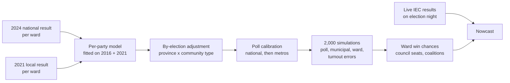

# How the LGE 2026 ward forecast was built

*Report date: 26 October 2026 · Election day: 4 November 2026 · Live map: <https://gavacharles.github.io/lge2026-ward-forecast/>*

This is an independent model, not affiliated with the Electoral Commission of South Africa (IEC), the
Municipal Demarcation Board (MDB) or any party. Its forecasts are probabilities. In some wards the
less likely outcome will happen.

## 1. Summary

The forecast gives a favourite and a win probability for each of South Africa's 4,485 wards in the
2026 local government elections, plus expected council seats and coalition arithmetic for every
municipality. It runs automatically, and on election night it switches to live updating from the IEC's
published results.

**Headline forecast (as of 26 October 2026):**

| Party | National ward-ballot share | Wards favoured | Expected wards won* |
| --- | --- | --- | --- |
| ANC | 29.7% | 2,482 | 2,307 |
| DA | 24.6% | 1,061 | 1,037 |
| MK | 13.2% | 747 | 699 |
| IFP | 3.5% | 111 | 162 |
| EFF | 8.0% | 28 | 124 |
| PA | 2.2% | 28 | 50 |
| FF+ | 3.0% | 20 | 44 |
| ActionSA | 3.3% | 2 | 27 |
| Local parties and independents | 12.4% | 8 | 35 |

\*Expected wards won is the sum of each ward's win probability. It differs from the favourite count
because a party that trails narrowly in many wards still wins some of them.

- **Competitiveness:** 487 wards are toss-ups (no party above a 60% chance), and 1,232 wards have a
  different favourite from their estimated 2021 winner.
- **Biggest swings:** ANC to MK (498 wards, mostly KwaZulu-Natal), ANC to DA (293) and IFP to MK (219).
- **Councils:** 154 of 213 councils are more likely than not to be hung. Cape Town is the only metro
  likely to have a single-party majority (DA, 72%).

**Does the method work?** It was re-run on the eve of the 2016 and 2021 elections, using only data
available then:

| Method | 2016 | 2021 |
| --- | --- | --- |
| Carry forward the previous local-election winner | 91.8% | 88.8% |
| Carry forward the last national-ballot winner | 92.8% | 89.3% |
| **This model** (with by-elections) | **94.2%** | **90.8%** |
| Ceiling: the model given each province's actual result | 94.6% | 91.2% |

The model beats the simple baselines in both years, and the gap to the ceiling is small. Most of the
remaining errors are local, ward-level surprises that no regional signal can predict.

## 2. Data sources

| Source | What we used | How we got it |
| --- | --- | --- |
| [IEC results portal](https://results.elections.org.za/home/) | Voting-district results for the 2011, 2016 and 2021 local elections (ward and PR ballots) and the 2014, 2019 and 2024 national elections | Found the static download links behind the portal's forms; downloads resume and are checked against the server's file size, because the IEC servers drop long transfers |
| IEC results portal, 2026 event | The voting districts that make up each 2026 ward: 23,696 voting districts in 4,485 wards | Scripted the portal's dropdowns (province, municipality, ward, voting district) for every municipality |
| IEC results portal, by-elections | 944 ward by-elections: 437 in the 2021–26 term (218 after the 2024 election), 295 in 2016–21 and 212 in 2011–16 | Downloaded each ward's detailed Excel report and parsed votes by party and voting district |
| [MDB Spatial Knowledge Hub](https://spatialhub-mdb-sa.opendata.arcgis.com/) | "MDB Wards 2026" boundary polygons for the map | Downloaded from the feature service, simplified on the server, converted to TopoJSON (2.9 MB) |
| [Wikipedia opinion polling tables](https://en.wikipedia.org/wiki/2026_South_African_municipal_elections) and [Daily Maverick](https://www.dailymaverick.co.za/article/2026-09-13-voters-splinter-among-parties-as-support-for-the-anc-plunges/) | National and metro polls from Ipsos, SRF/The Common Sense, SABI Strategy Group/News24 and eNCA/MarkData; final 2024 polls for pollster house effects | A parser reads Wikipedia's tables daily. Metro subsamples reported only in the press are entered by hand |

**What we could not get as data:**
- **Census 2022 ward profiles.** Stats SA has not released the Community Profile tables by ward, and
  its ward-level small-area estimates sit behind a bot-protected page with no direct file link. The
  model uses voting-pattern community types instead (section 5).
- **2026 ward candidate lists.** The IEC publishes these only as web pages, or through its
  credentialed API. The model accepts a list if one is supplied (section 6).
- **2026 voter-roll changes by voting district.** These are not published as a download.
  Differential turnout is simulated instead (section 6).
- **WardBeat.** It has no election results and its ward detail is behind a subscription, so it was not used.

## 3. Rebuilding history inside the 2026 wards

Ward boundaries changed for 2026. In Tshwane, for example, 27 of 107 wards kept their boundaries.
Comparing a 2026 ward with the 2021 ward of the same number would therefore be wrong. Voting districts
are much more stable, so every past result is re-added inside the new wards, district by district.

- **Coverage:** 97% of 2026 voting districts have a 2024 national result and 96% have a 2021 local
  result. A ward with no matched districts takes its municipality's result.
- **Ward count:** the IEC portal lists 4,485 wards. The MDB's published total is 4,488, and the three
  missing wards are in the Free State.
- **Checks:** the rebuilt national totals reproduce the official results, for example ANC 40.18% and
  MK 14.58% in 2024, ANC 62.15% in 2014, and ANC 62.9% / DA 24.1% on the 2011 PR ballot.

## 4. The core model



**Structure from history.** For each party, a ward's local ward-ballot share is modelled on the
logit scale as

```latex
\operatorname{logit}(s_{\text{LGE}}) = a_p + b_p\,\operatorname{logit}(s_{\text{latest NPE}}) + c_p\,\operatorname{logit}(s_{\text{previous LGE}})
```

The coefficients are pooled over the 2016 and 2021 cycles. The latest national result carries most of
the weight (b ≈ 0.7 to 1.0). The previous local result adds local loyalty for the ANC, DA, IFP and FF+
(c ≈ 0.17 to 0.32), and almost none for the EFF (c ≈ −0.09). MK, the
PA and ActionSA have too little history for their own coefficients, so they use the pooled ones.

**MK.** MK first contested in 2024 and had no 2021 local result. A ward's 2021 ANC local vote is
therefore split between the ANC and MK in that ward's 2024 ANC-to-MK ratio before it enters the model.

**Levels from polls.** The model sets the pattern across wards; the polls set each party's overall
level. Shares are scaled multiplicatively until the national total matches the poll average. In metros
with their own polls, the forecast is then pulled part of the way towards those polls; the rest of the
country absorbs the remainder so the national total still holds.

**Independents and local parties.** Polls under-measure these. Their share ("Other") is held at its
2021 ward-ballot level in the 2026 wards (12.4%), and the polled parties share the rest in poll
proportions. Where a local party is the largest "other", it can be a ward's favourite.

## 5. By-elections and community types

**Measuring local swing.** For each ward by-election held after a national election, the model compares
each party's share with what the same voting districts gave it in that national election:
r = log(by-election share ÷ national-election share). The average across all by-elections (the national
drift, which polls already cover) is removed. What is left is estimated by province and by community
type within province, shrunk towards zero: effect = Σr ÷ (n + 10).

**Community types.** Without census data, voting districts are grouped into 8 types by their party mix
in the 2024 national election (k-means, weighted by votes). In South Africa party mix tracks language
and population group closely, so the types act as demographic strata:

| Community type (2024 vote) | 2026 wards | In metros | Main provinces (wards) |
| --- | --- | --- | --- |
| ANC 63% / EFF 18% | 1,225 | 16% | North West 276, Free State 213, Limpopo 195 |
| ANC 81% / EFF 8% | 884 | 2% | Eastern Cape 404, Limpopo 340, North West 68 |
| ANC 51% / MK 19% | 502 | 30% | Mpumalanga 226, Gauteng 218, KwaZulu-Natal 34 |
| MK 39% / IFP 38% | 448 | 1% | KwaZulu-Natal 447 |
| DA 42% / ANC 20% | 396 | 30% | Gauteng 110, KwaZulu-Natal 57, Free State 56 |
| MK 62% / ANC 21% | 382 | 22% | KwaZulu-Natal 353, Mpumalanga 24 |
| DA 73% / Other 8% | 326 | 43% | Western Cape 145, Gauteng 70, KwaZulu-Natal 29 |
| DA 41% / PA 22% | 321 | 13% | Western Cape 177, Northern Cape 80, Eastern Cape 45 |

**How strong should the adjustment be?** It was tuned on the 2016 and 2021 backtests. The best setting
applied a quarter of the measured effect (alpha = 0.25, shrinkage k = 10). That raised accuracy by 0.4
points in 2016 and lowered it by 0.1 points in 2021. By-elections carry a real but weak signal: they have
low turnout, strong candidate effects, and few by-elections fall in any one province and community type.

**What the 2024–26 by-elections say about KwaZulu-Natal:**
- Across about 40 KwaZulu-Natal by-elections, MK ran about 21% below its 2024 level relative to other
  parties (effect −0.24), and the ANC recovered (+0.24).
- The IFP held roughly level overall: about +5% (after shrinkage) where it contests MK head to head
  ("MK 39% / IFP 38%"), and +17% in MK-dominant areas ("MK 62% / ANC 21%").
- So the evidence points to MK slipping more than to an IFP surge. Because the adjustment is applied
  at a quarter of strength, the forecast still has MK favoured in many 2021 IFP wards (219 flips). This
  is the forecast's least certain area.

## 6. Polls, turnout, candidates and uncertainty

**Poll average.** Each poll's weight is √(sample ÷ 1,000) × 0.5^(age in days ÷ 30), so it halves every
30 days. Each pollster's lean is measured from its final 2024 poll against the 2024 result, and half
of it is removed:

| Pollster | Lean removed (points: ANC, DA, MK, EFF) | 2024 poll used |
| --- | --- | --- |
| SRF / The Common Sense | +1.0, −0.1, −1.1, +0.6 | 27 May 2024 |
| eNCA / MarkData | +1.6, −1.6, −0.2, +0.9 | May 2024 |
| Ipsos | 0.0, 0.0, −3.1, +1.0 | ended 15 April 2024; MK's later surge inflates its MK figure |
| SABI / News24 | none (no 2024 poll) | — |

Current average, with spread: ANC 31.3% ±2.1, DA 25.9% ±2.1, MK 13.9% ±2.4, EFF 8.4% ±2.8, IFP 3.7%,
FF+ 3.2%, ActionSA 3.5%, PA 2.3%. The ± combines disagreement between polls with a 2-point allowance
for the typical error of a final poll average. In the forecast these are shares of all votes, so they are
scaled down by the 12.4% held for "Other".

A metro's pull towards its own polls grows with its effective sample size: n ÷ (n + 800). That gives 0.61
for Johannesburg, Tshwane and eThekwini, 0.51 for Cape Town, about 0.36 for Ekurhuleni and Nelson
Mandela Bay, and 0.2 for Buffalo City and Mangaung, which have only small Ipsos subsamples.

**Uncertainty.** Each of 2,000 simulations draws:
- **National poll error:** per party, sized from the poll spread.
- **Municipal surprise:** standard deviation 0.23 on the log scale, measured in the backtests and
  smaller in well-polled metros.
- **Ward surprise:** standard deviation 0.27, fat-tailed (t-distribution, 5 degrees of freedom).
- **Differential-turnout shock:** each party's sensitivity is measured from 2021 ward turnout. The DA
  and FF+ do better where turnout is high, the ANC, EFF and MK where it is low. The shock's size (0.25)
  is an assumption, not an estimate.

**Calibration.** In both backtests, wards rated 60–90% were won by the favourite slightly more often
than predicted (for example 72.8% of the 60–70% group in 2021). The 95%+ group was slightly
overconfident: 97.2% won against 98.7% predicted in 2021. The Brier score for the winner's
probability was 0.050 in 2016 and 0.083 in 2021.

**Candidates.** If `config/candidates_2026.csv` (ward, party) is supplied, parties without a candidate in
a ward are removed there and the shares re-normalised. This run has no list.

## 7. Council seats and coalitions

Seats follow the local-government formula in Schedule 1 of the Municipal Structures Act, simplified:
1. Ward and PR votes are combined.
2. Seats are shared by a quota and largest remainders.
3. A party fills its share with the wards it won first.
4. A party that wins more wards than its share keeps them, and the rest of the seats are re-shared.

Councils are assumed to have twice as many seats as wards, because the 2026 seat numbers are not
published as data. A check against Johannesburg's 2021 vote shares gave ANC 91, DA 70, ActionSA 43
and EFF 29 seats, against 91, 71, 44 and 29 in the council.

| Metro | Largest party (chance) | Hung council | Expected seats: ANC / DA / MK / EFF / ActionSA | Seats |
| --- | --- | --- | --- | --- |
| Johannesburg | DA (91%) | 100% | 54 / 82 / 30 / 23 / 31 | 270 |
| Cape Town | DA (100%) | 28% | 37 / 126 / 3 / 14 / 4 | 236 |
| eThekwini | MK (95%) | 98% | 23 / 60 / 91 / 5 / 4 | 224 |
| Tshwane | DA (74%) | 100% | 55 / 65 / 10 / 20 / 22 | 214 |
| Ekurhuleni | DA (66%) | 100% | 55 / 63 / 28 / 19 / 17 | 224 |
| Nelson Mandela Bay | DA (84%) | 100% | 35 / 44 / 2 / 10 / 3 | 120 |
| Buffalo City | ANC (96%) | 97% | 39 / 22 / 2 / 16 / 3 | 100 |
| Mangaung | ANC (84%) | 100% | 36 / 28 / 2 / 12 / 3 | 102 |

**Coalition arithmetic:** the chance that each group holds a majority of seats. These are sums of
seats, not predictions of deals.

| Metro | ANC + EFF | ANC + MK + EFF | ANC + DA | DA + FF+ + ActionSA + IFP | ANC + DA + IFP |
| --- | --- | --- | --- | --- | --- |
| Johannesburg | 0% | 1% | 50% | 18% | 62% |
| eThekwini | 0% | 70% | 0% | 0% | 8% |
| Tshwane | 0% | 0% | 88% | 31% | 88% |
| Ekurhuleni | 0% | 14% | 66% | 5% | 75% |
| Buffalo City | 71% | 80% | 97% | 0% | 97% |
| Mangaung | 25% | 42% | 98% | 0% | 98% |

## 8. Election night: the live nowcast

From 4 November the IEC publishes results by voting district. Every 15 minutes the nowcast:
1. Counts reported voting districts as they are.
2. Measures the reported districts' swing against their forecast, by municipality (shrunk towards the
   province), and applies it to the districts still out.
3. Scales expected turnout in unreported districts by the reported districts' turnout against 2021.
4. Re-simulates the uncertain remainder; uncertainty shrinks as a ward's count completes.

Replaying 2021 with voting districts revealed in random order:

| Voting districts reported | 0% | 10% | 25% | 50% | 75% |
| --- | --- | --- | --- | --- | --- |
| Wards called correctly | 90.8% | 91.6% | 92.4% | 93.6% | 95.4% |

The site shows a "Live count" banner and each ward's counted share once results flow.

## 9. Automation

| Workflow | When | What it does |
| --- | --- | --- |
| Forecast (`.github/workflows/forecast.yml`) | On every change to config, code or data; daily at 06:00 SAST; on demand | Runs the backtests, the forecast and the site build, then commits the updated outputs |
| Poll update (`polls.yml`) | Daily at 08:00 SAST | Reads Wikipedia's poll tables; if they changed, opens a pull request for review. Merging it re-runs the forecast |
| Election night (`election-night.yml`) | Every 15 minutes, 4–6 November (UTC) | Pulls the IEC's 2026 results, runs the nowcast and republishes the site |

The processed data (about 10 MB) is committed under `data/interim`, so the workflows never depend on
the IEC's slow servers. GitHub can delay scheduled runs; `src/election_night.sh` does the same job from
a local machine every 10 minutes.

## 10. Limitations and what to watch

- **KwaZulu-Natal.** The IFP–MK contest is the least certain part. By-elections suggest MK has slipped
  since 2024, but the backtests support only a light adjustment.
- **Local effects dominate the errors.** Even with perfect provincial polls, about 9% (2021) and 5% (2016)
  of wards go against the model. These are local candidates, defections and community issues.
- **"Other" is held at its 2021 level.** New parties such as Unite for Change, Afrika Mayibuye and the
  SACP standing alone sit inside it. Their combined strength could differ from 2021's mix of local
  parties and independents.
- **Turnout.** The size of the differential-turnout shock is an assumption. Turnout of about 42%,
  as some forecasts suggest, would favour parties with reliable voters (DA, FF+).
- **Seat counts** assume 2 × wards per council. The real numbers can differ by one seat, which matters
  for knife-edge majorities.
- **Polls** are few outside the metros. Buffalo City and Mangaung rely on small subsamples.
- **Three Free State wards** are missing from the IEC portal's 2026 lists.

## 11. Reproducing the work

```sh
pip install -r requirements.txt
python src/pipeline.py --refresh-data   # download IEC files, rescrape by-elections, rebuild, snapshot
python src/pipeline.py                  # backtest -> forecast -> site (about 20 seconds)
python src/nowcast.py replay            # test the election-night nowcast on 2021
python src/update_polls.py              # refresh polls from Wikipedia
```

| Path | Contents |
| --- | --- |
| `src/scrape_wards2026.py`, `scrape_byelections.py`, `download.py`, `fetch_boundaries.py` | Data collection |
| `src/build_data.py` | Voting-district tables for six elections |
| `src/model.py`, `community.py`, `byelections.py`, `polls.py`, `seats.py` | Model components |
| `src/backtest.py`, `forecast_2026.py`, `nowcast.py` | Backtests, forecast, live updates |
| `src/build_site.py`, `docs/` | The public map (GitHub Pages) |
| `config/` | Polls, 2024 final polls, coalition groups, optional candidate list |
| `outputs/` | Ward and municipality forecasts, backtest results, calibration, by-election residuals |

## Sources

- IEC results portal: <https://results.elections.org.za/home/>
- MDB Spatial Knowledge Hub, MDB Wards 2026: <https://spatialhub-mdb-sa.opendata.arcgis.com/>
- Wikipedia, 2026 South African municipal elections (opinion polls): <https://en.wikipedia.org/wiki/2026_South_African_municipal_elections>
- Wikipedia, 2024 South African general election (final polls): <https://en.wikipedia.org/wiki/2024_South_African_general_election>
- Daily Maverick, "Voters splinter among parties as support for the ANC plunges" (13 September 2026): <https://www.dailymaverick.co.za/article/2026-09-13-voters-splinter-among-parties-as-support-for-the-anc-plunges/>
- eNCA, "Why some South Africans will vote in a different ward in 2026": <https://www.enca.com/opinion/explainer-why-some-south-africans-will-vote-different-ward-2026>
- Stats SA, Ward-level Small Area Population Estimates 2022 (technical note): <https://www.statssa.gov.za/wp-content/uploads/2025/11/Ward-statistical-product-technical-note.pdf>
